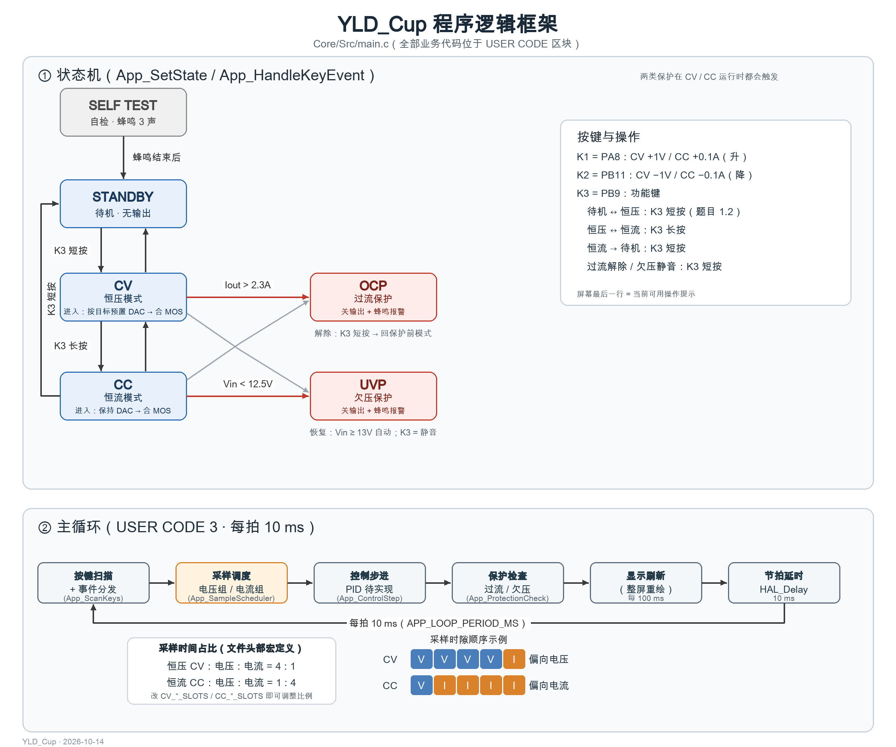

# Core 使用须知（main.c 业务逻辑）

本目录的 `Src/main.c` 是工程主逻辑：CubeMX 生成的初始化骨架 + 写在 `USER CODE` 区块内的业务代码。**只改 `USER CODE` 区块**；重新生成的安全规则见根 [README.md](../README.md) 的"重新生成代码（CubeMX）"一节。

一句话版：**改参数看第 2 节，改逻辑看第 4 节，生成区别碰。**

## 1. 代码地图（USER CODE 区块 → 内容）

| 区块 | 内容 |
| --- | --- |
| Includes | `AD5662.h` / `OLED.h`；新增头文件放这里 |
| PTD | `AppState_t`（状态机）、`KeyEvent_t` / `Key_t`（按键） |
| PD | **全部可调参数**（第 2 节速查） |
| PV | 状态、设定值、测量值、按键对象、循环节拍 |
| PFP | 函数原型；新增函数必须在这里声明 |
| 2 | 上电流程：OLED → 关输出 → DAC 预置 → ADC 校准 → 蜂鸣 3 声 → 待机 |
| 3 | 主循环：按键 → 采样 → 控制 → 保护 → 显示 → 节拍延时（10 ms） |
| 4 | 函数实现：`ADC_ReadVoltage()` + 全部 `App_*()` |

## 2. 可调参数速查（都在 PD 区，改参数只动这一块）

### 2.1 采样时间占比（恒压偏电压 / 恒流偏电流）

| 宏 | 当前值 | 含义 |
| --- | --- | --- |
| `CV_VOLT_SLOTS` : `CV_CURR_SLOTS` | 4 : 1 | 恒压模式每 5 拍里 4 拍采电压组（Vin/Vout）、1 拍采电流组（Iin/Iout） |
| `CC_VOLT_SLOTS` : `CC_CURR_SLOTS` | 1 : 4 | 恒流模式反过来（偏向电流） |

改占比：直接改这四个正整数（比如 9 : 1）；两边都配 0 时退化为只采电压组（防呆分支）。

### 2.2 测量标定（真值 = (ADC 电压 − offset) × scale）

| 宏 | 当前值 | 说明 |
| --- | --- | --- |
| `VIN_ADC_SCALE` / `VOUT_ADC_SCALE` | 7.0 | 分压比（输入/输出电压 ÷7 进 ADC），实测后微调 |
| `IIN_SHUNT_OHM` / `IOUT_SHUNT_OHM` | 0.005（占位） | 输入（R6）/ 输出（R7）电流采样电阻，实测后只改这里 |
| `INA199_GAIN` | 50.0 | INA199 增益，看丝印：OBG=50 / OBH=100 / OBI=200 |
| `IIN_ADC_SCALE` / `IOUT_ADC_SCALE` | 自动折算 | = 1 / (采样电阻 × 增益)，改上面两个宏即可，不用手算 |
| 四个 `*_ADC_OFFSET` | 0.0 | 零点偏置：输出关断时读到的值直接填进来 |

采样电阻与增益未最终确定前，先按 0.005Ω × 50 倍占位（等效 scale = 4.0）；实物定值后只需替换 `IIN/IOUT_SHUNT_OHM` 与 `INA199_GAIN`。

标定流程：① 待机（输出关断）读原始读数 → 填 `offset`；② 带载后与台式表对比两三个点，按比例修 `scale`。

标定工具：TEST/ 提供独立标定固件（单独编译/烧录，不改动主程序），实时显示各通道原始值；说明、公式与算例见 [TEST/README.md](../TEST/README.md)。

### 2.3 其它常用宏

| 宏 | 当前值 | 说明 |
| --- | --- | --- |
| `VOUT_TARGET_DEFAULT / MIN / MAX / VOUT_STEP` | 8 / 5 / 15 / 1.0 | 步进调压默认值与范围（题目 2.2） |
| `IOUT_TARGET_* / IOUT_STEP` | 1 / 0.2 / 2 / 0.1 | 恒流模式设定与步进 |
| `OCP_TRIP_A` / `OCP_CONFIRM_MS` / `UVP_TRIP_V` / `UVP_RECOVER_V` | 2.3 / 50 / 12.5 / 13.0 | 过流阈值、过流确认窗口 (ms)、欠压阈值与恢复迟滞 |
| `PROT_BLANK_MS` | 300 | 合闸后的保护屏蔽期（防浪涌误触发） |
| `APP_LOOP_PERIOD_MS` / `DISPLAY_REFRESH_MS` | 10 / 100 ms | 主循环节拍 / 屏幕刷新周期 |
| `KEY_DEBOUNCE_MS` / `KEY_LONG_MS` | 20 / 800 ms | 按键消抖 / 长按判定 |
| `BEEP_ON_MS / BEEP_GAP_MS / BEEP_STARTUP_TIMES` | 200 / 500 / 3 | 开机蜂鸣节奏 |
| `VOUT_DAC_A / VOUT_DAC_B` | 16.4 / 4.0 | 目标电压 → DAC 传递关系（理论值；方向：DAC↑ → Vout↓） |

## 3. 按键操作（与屏幕提示行一一对应）

- **K3 = PB9 功能键**：待机 ↔ 恒压（短按）、恒压 ↔ 恒流（长按）、过流解除、欠压静音；
- **K1 = PA8 / K2 = PB11**：只在运行状态有效（CV 调 ±1V，CC 调 ±0.1A），待机与保护状态下无动作；
- 长按触发后松手不会再产生短按事件。

## 4. 常见改动怎么做

- **加一个状态**：`AppState_t` 加枚举 → `App_SetState()` 的 switch 加"进入动作" → `App_HandleKeyEvent()` 加按键响应 → `App_StateText()` 加屏幕文案。
- **改按键分工**：只动 `App_HandleKeyEvent()`。
- **改主循环步骤**：`USER CODE 3` 里的 6 个步骤，按注释增删。
- **实现 PID**：填 `App_ControlStep()`（函数头注释里写好了误差定义与负增益方向）。
- **改屏幕布局**：`App_UpdateDisplay()` + PD 区的 `OLED_*` 布局宏。

## 5. 注意事项

1. `App_ControlStep()` 目前是占位——CV/CC 靠开环预置，不会精确闭环，属预期；接线与标定完成后再填 PID。
2. `ADC_ReadVoltage()` 每次调用都会重配 ADC 通道并做 4 次均值转换（约百微秒级），不要放进中断；采样节奏交给 `App_SampleScheduler()`。
3. 显示是整屏重绘（100 ms 一次）；以后若要改回局部刷新，注意 `OLED_UpdateArea()` 以页（8px）为粒度。
4. 生成区（`MX_*_Init()`、`SystemClock_Config()`）不要手改；要改参数先改 `.ioc` 再生成（流程见根 README 安全清单；SPI2 参数见 [AD5662/README.md](../AD5662/README.md) 第 2 节）。
5. 屏幕数值用驱动自带的 `OLED_ShowFloatNum`，固定带 `+` 号；在意排版再自行格式化。
