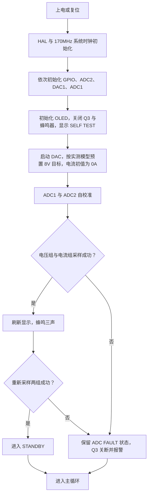
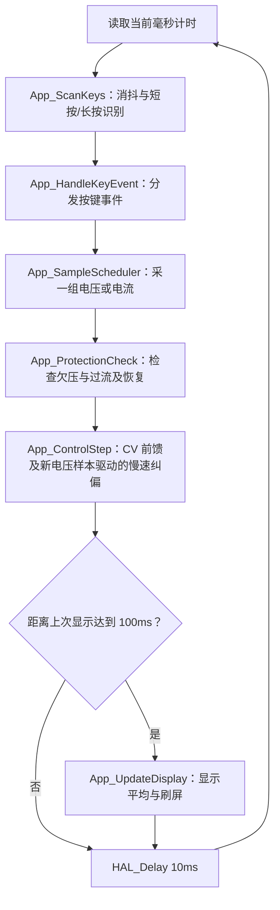
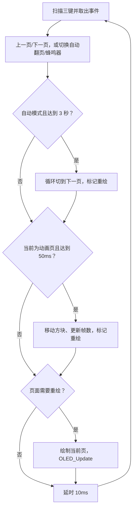
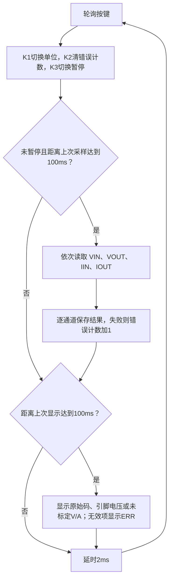

# 主程序与各测试文件流程

本文说明七个固件入口、共用板级文件和七个主机验证脚本。详细测量接线见 [模块测试说明](TEST_MODULES/README.md)，标定公式见 [标定说明](TEST/README.md)，恒流自动识别、阶跃及手动试参流程见 [恒流调参说明](TEST_PID/README.md)。

**V2.10 的 `App_ControlStep()` 在 CV 下执行两步前馈与慢速积分电压闭环，见 [自动纠偏说明](calibration/cv_feedback_2026-10-27.md)。主程序 CC 仍无恒流调节；独立调参固件另行实现恒流 PI/PID。**

## 1. 文件、目标与运行方式

| 文件 | CMake Target / 运行命令 | 用途 | PA1 / Q3 |
| --- | --- | --- | --- |
| [Core/Src/main.c](Core/Src/main.c) | `YLD_Cup` | 整机状态机、采样、开环调压、显示与保护 | 运行态导通，待机/保护关断 |
| [TEST_OLED/oled_test_main.c](TEST_OLED/oled_test_main.c) | `YLD_Cup_OLEDTest` | 六页屏幕测试 | 始终关断 |
| [TEST_MODULES/gpio_test_main.c](TEST_MODULES/gpio_test_main.c) | `YLD_Cup_GPIOTest` | 按键状态、计数和蜂鸣器 | 始终关断 |
| [TEST_MODULES/opamp_test_main.c](TEST_MODULES/opamp_test_main.c) | `YLD_Cup_OpampTest` | 内部 DAC 与 OPA320 跟随器 | 始终关断 |
| [TEST_MODULES/adc_test_main.c](TEST_MODULES/adc_test_main.c) | `YLD_Cup_ADCTest` | 四路原始采样及未标定换算 | 始终关断 |
| [TEST/calib_main.c](TEST/calib_main.c) | `YLD_Cup_Calib` | 开环调压、手动通断与带载标定 | K3 手动切换 |
| [TEST_PID/cc_pid_main.c](TEST_PID/cc_pid_main.c) | `YLD_Cup_CCPIDTune` | 独立恒流 PI/PID 实测调参、阶跃验证 | 按键启动，结束或故障关断 |
| [tests/run_main_logic.py](tests/run_main_logic.py) | `python3 tests/run_main_logic.py` | 在电脑模拟主程序部分逻辑 | 不访问实物 |
| [tests/run_module_logic.py](tests/run_module_logic.py) | `python3 tests/run_module_logic.py` | 在电脑模拟共用模块测试函数 | 不访问实物 |
| [tests/run_cc_pid.py](tests/run_cc_pid.py) | `python3 tests/run_cc_pid.py` | 在电脑验证恒流识别、调节与保护逻辑 | 不访问实物 |

七个固件各有自己的 `main()`，通过不同目标生成独立 ELF；每次烧录其中一个，板上只运行该程序。构建全部目标不会让它们在板上同时执行，切回主程序时需要重新烧录 `YLD_Cup.elf`。

```sh
cmake --preset Debug
cmake --build --preset Debug --target YLD_Cup
cmake --build --preset Debug --target YLD_Cup_OLEDTest
cmake --build --preset Debug --target YLD_Cup_GPIOTest
cmake --build --preset Debug --target YLD_Cup_OpampTest
cmake --build --preset Debug --target YLD_Cup_ADCTest
cmake --build --preset Debug --target YLD_Cup_Calib
cmake --build --preset Debug --target YLD_Cup_CCPIDTune
```

ELF 路径：主程序在 `build/Debug/`；屏幕、标定固件分别在其下的 `TEST_OLED/`、`TEST/`；三个模块固件在 `TEST_MODULES/`；恒流调参固件在 `TEST_PID/`。CLion 的运行/调试配置选择相应 Target 后，通过 SWD 烧录。

## 2. 公共硬件与数据流

| 信号 | 引脚 | 软件中的含义 |
| --- | --- | --- |
| Vin | PA7 / ADC2_IN4 | 输入电压分压节点，电压乘 7 |
| Vout | PA6 / ADC2_IN3 | 正输出对系统地的分压节点，电压乘 7 |
| Iin | PB1 / ADC1_IN12 | 输入 INA199 输出；20mΩ、50 倍增益时名义 1A/V |
| Iout | PB0 / ADC1_IN15 | 输出 INA199 输出；20mΩ、50 倍增益时名义 1A/V |
| DAC | PA4 / DAC1_OUT1 | 经 OPA320、R13 注入 LM2596 FB |
| 输出控制 | PA1 | 高电平使 Q3 导通 |
| 蜂鸣器控制 | PA2 / AF1 / TIM2_CH3 | 约 2.4kHz、50% 占空比 PWM 驱动 Q2，低电平静音 |
| OLED | PB3 / PB4 | 软件 I2C 的 SCL / SDA |
| K1 / K2 / K3 | PB15 / PB14 / PB13 | 上拉输入，按下为低电平 |

默认 ADC/DAC 基准按 3.3V 换算。V2.08 先按两步实测模型反解原设定量 S，再用采集时的基础映射 `S = 17.07091 − 4.545455 × Vdac` 换算，因此 DAC 电压升高会使输出降低。数据范围与外推边界见电压校准说明。

Q3 位于输出负端。关断只表示负端回路断开，正端仍可能带电。屏幕、GPIO、运放测试只接逻辑 5V，断开降压主输入与负载；ADC 和带载标定的分阶段接线见各自说明。

## 3. 主程序 `Core/Src/main.c`

### 3.1 启动流程



初始化、自校准或 DAC 调用失败会进入 `Error_Handler()`：关 Q3、开报警、关中断并停机，不进入正常主循环。运行采样失败则进入可按 K3 重试的 `ADC FAULT` 状态，两种错误处理不同。

开机蜂鸣每声 200ms，随后停 500ms，共三次。`Buzzer_Init()` 在 GPIO/ADC/DAC 初始化后、OLED 初始化前启动静音 PWM；`App_Buzzer()` 通过共用驱动切换占空比。该阶段使用阻塞延时，硬件 TIM2 持续产生载波，Q3 保持关断；蜂鸣结束后重新采样，避免直接沿用启动前的旧读数。TIM2 不使用中断，进入主程序 Error_Handler 关中断后也能持续报警。

### 3.2 主循环顺序



循环末尾延时 10ms，加上 ADC、OLED 和其他处理耗时，实际循环周期大于 10ms且会变化。当前采样、CV 控制、保护均由主循环调用。慢速纠偏只在新电压样本且达到 100ms 间隔时更新，按实际经过时间积分；超过 500ms 则重建滤波而不补积历史误差。该外环用于慢漂，快速动态控制仍需台架整定。

### 3.3 采样与显示

`App_SampleScheduler()` 每轮消费一个时隙；CV 及其他非 CC 状态按“电压、电压、电压、电压、电流”循环，CC 按“电压、电流、电流、电流、电流”循环。每组有两个通道，每通道切换后弃首样，再平均 4 次；ADC 采样时间为 640.5 周期。

V2.06 中 Vin 按分压比换算，表示 D4 后节点；电流在名义 1A/V 后做二次校正，超出实测上限按切线延伸，负值钳到 0A。Vout 由 PA6 名义电压和校正后的 Iout 共同估算，电压组或电流组刷新时均重算。主程序与独立恒流调参固件共用 `measurement_calibration.h`，数据和公式见 [实测换算说明](calibration/README.md)。不做上电自动归零。采样失败立即进入 ADC 故障，不能当成真实 0V/0A。

屏幕约每 100ms 刷新一次，取最近三次显示数据的平均，状态切换时重置平均窗口。保护使用 `meas*` 测量值，不使用显示平均值。非运行状态把屏幕 Vout 显示为 0，表示输出禁用，**该 0 不是对两端子压差的测量**；`measVoutNominal` 保存 PA6 正端对系统地的名义电压。

### 3.4 状态、按键与保护

主程序消抖为 20ms，短按在松手时产生；长按在消抖确认按下后达到 800ms 时触发一次，之后松手不再产生短按。K1/K2 长按连发尚未实现。

| 当前状态 | K1 / K2 短按 | K3 短按 | K3 长按 | 进入状态时的输出行为 |
| --- | --- | --- | --- | --- |
| STANDBY | 无动作 | 请求进入 CV | 无动作 | Q3 关断、停止报警 |
| CV | 目标电压 ±1V，范围 5～15V，同步更新 DAC | 回待机 | 切 CC | 按目标预置 DAC，再开 Q3 |
| CC | 目标电流 ±0.1A，范围 0.2～2.0A | 回待机 | 切 CV | 保持现有 DAC，开 Q3；尚无恒流调节 |
| OCP | 无动作 | 尝试恢复保护前模式 | 无动作 | Q3 关断并报警 |
| UVP | 无动作 | 暂时静音 | 无动作 | Q3 关断并报警 |
| ADC FAULT | 无动作 | 重采两组，成功后回待机 | 无动作 | Q3 关断并报警 |

所有请求进入 CV/CC 的路径都会先重新采两组信号；采样失败保持 ADC 故障，输入低于 12.5V 则进入欠压保护，满足条件才允许合闸。

| 条件 | 检查与动作 | 恢复方式 |
| --- | --- | --- |
| Vin < 12.5V 连续确认3秒 | 运行态关 Q3，进入 UVP；正常电压样本清零计时，确认不受过流屏蔽期影响 | Vin ≥13.0V 后自动请求恢复保护前模式 |
| Iout >2.3A | 合闸后先屏蔽过流 300ms；之后按新电流样本确认持续至少 50ms，进入 OCP | K3 短按请求恢复，合闸前再次采样检查 |
| ADC 调用失败 | 立即进入 ADC FAULT，关 Q3 并报警 | K3 重试成功只回待机，再按一次才请求运行 |
| 初始化或 DAC HAL 调用失败 | `Error_Handler()` 关 Q3、开报警并停机 | 排查原因后复位 |

过流计时从首次超限的新样本开始，只有后续新电流样本参与判定，正常样本会清除确认计时。因此“50ms”是确认阈值，实际动作还受采样调度影响。运行中UVP同样只消费新电压样本：从首次低于12.5V开始计时，后续低压样本确认经过至少3000ms才关断；任一达到12.5V的样本清零。状态切换清除欠压计时，合闸前已欠压仍立即禁止输出并报警。实际动作受采样调度影响，不能据此证明样本之间电压一直低于门限；UVP不是独立硬件比较器的即时保护。

## 4. 屏幕测试 `TEST_OLED/oled_test_main.c`

**启动：** `HAL_Init → 系统时钟 → GPIO → 蜂鸣器 PWM 初始化（静音）→ OLED 初始化 → 全白400ms → 全黑200ms → 初始化翻页/动画计时`。不初始化 ADC/DAC，Q3 始终关闭。



页面依次为文字/汉字、像素网格、条纹、密度、图形、动画。默认每 3 秒循环翻页；K1 上一页，K2 下一页，K3 短按开关自动翻页，长按 800ms 开关持续蜂鸣。短按在松手时触发，静态页按需重绘，动画页按约 50ms 节拍重绘。细节见 [屏幕说明](TEST_OLED/README.md)。

## 5. 三个新增模块测试的公共流程

[TEST_MODULES/test_board.c](TEST_MODULES/test_board.c) 提供辅助函数，本身没有 `main()`；三个模块目标各自链接一份，运行状态互不共享，也不调用主程序的 `App_*` 函数。

| 函数 | 执行流程 |
| --- | --- |
| `TB_Init()` | HAL 初始化 → 使能 GPIO 时钟 → PA1/PA2 拉低并设为输出 → 采样/DAC 引脚设模拟模式 → 三键设上拉 → 配置 170MHz 系统时钟 → 蜂鸣器 PWM 初始化（静音） |
| `TB_KeysPoll()` | 读取原始按下状态 → 20ms 消抖 → 返回本次按下事件位 → 更新原始/稳定状态及心跳 |
| `TB_DacInit()` | 初始化 DAC、配置通道 → 预装目标码值 → 启动 DAC |
| `TB_DacWrite()` | 电压限制到 0.2～3.1V → 四舍五入换算 12 位码 → HAL 写入 → 更新调试变量；非有限输入回退到 3.0V |
| `TB_AdcInit()` | 初始化 ADC1 → 独立模式配置 → 初始化 ADC2 → 分别自校准 |
| `TB_AdcRead()` | 校验参数 → 停止 ADC → 配置通道 → 17次转换，弃首样再平均16次 → 更新码值、电压和有效标志 |
| `TB_Buzzer()` | 调用共用 `Buzzer_Set()`，切换 PA2 PWM 发声/低电平静音 |

这里的按键事件在**确认按下时**产生，按住不连发，也没有长按功能。与主程序、OLED 测试的“松手产生短按”不同。

初始化或 DAC 写入失败进入 `Fail()`，保存 `tb_status.fault`、关 PA1/PA2、关中断并停机，故障码见 [模块测试说明](TEST_MODULES/README.md)。单次 ADC 读取失败返回 `false`、`valid=false`，由 ADC 测试决定如何显示和重试。`tb_status.heartbeat` 随按键轮询更新；`fault=0` 只表示没有记录到致命初始化/写 DAC 错误，不能代表硬件测试通过。

### 5.1 按键/蜂鸣器 `gpio_test_main.c`

**启动：** `TB_Init → OLED_Init → 设置首次刷新时间`，不初始化 ADC/DAC。

**循环：** `TB_KeysPoll → 按下事件对应计数加1 → 设置蜂鸣序列及起点 → 按经过时间更新 PA2 → 每100ms更新屏幕 → 延时2ms → 重复`。

K1/K2/K3 分别触发 1/2/3 声，每声 PWM 发声 100ms、低电平静音 100ms；新事件覆盖未完成序列，同轮多键事件按 K1→K2→K3 处理，后处理的键决定蜂鸣序列。屏幕显示稳定按键状态、次数、最后一个键。可在 Watch 查看 `gpio_press_count[3]`、`gpio_last_key`；无屏幕时仍可用蜂鸣和调试变量检查。无源蜂鸣器由共用 `buzzer.c` 的 TIM2_CH3 持续提供约 2.4kHz 载波。

### 5.2 DAC/运放 `opamp_test_main.c`

**启动：** `TB_Init → 按第3号档位初始化 DAC=2.0V → OLED_Init → 初始化切档/显示计时`，不初始化 ADC。

**循环：** `轮询三键 → K3切换自动模式 → K1/K2处理手动切档 → 判断自动5秒切档 → 若档位改变则写DAC → 每100ms刷新命令电压、码值与模式 → 延时2ms → 重复`。

档位表为 `0.5、1.0、1.5、2.0、2.5、3.0V`。K1 升档、K2 降档，到边界停止且退出自动模式；K3 开关自动模式，自动档位到末尾后循环回首档。Watch 查看 `opamp_level`、`opamp_auto` 和 `tb_status.dac_code/dac_v`。

程序只发出 DAC 命令，没有测量运放输出、没有自动 PASS 判定。需要用万用表对照 PA4 及 U2 的3脚输入、1脚输出、4脚反馈；屏幕 `CMD` 是按假定基准算出的命令值。此固件的0.5V档间变化用于静态测量，未提供 PID 小阶跃采集流程。

### 5.3 四路 ADC `adc_test_main.c`

**启动：** `TB_Init → DAC固定2.0V → ADC1/ADC2初始化与校准 → OLED_Init → 设置立即采样/刷新`。固定 DAC 用于避免 PA4 浮空，不自动扫描电压，Q3 关闭。



K1 在引脚电压与物理量估算之间切换：电压通道乘7，电流通道按1A/V显示；这些不是已标定精度。K3 暂停只停止新采样，屏幕继续刷新，并以 `HOLD` 标明保留读数。K2 只清累计错误次数，不会修复采样故障；同轮若再次读取失败，计数会重新增加。

Watch 查看 `adc_samples[0..3]` 的 `code/pin_v/valid`、`adc_error_count`、`adc_hold`、`adc_physical`。一次采样失败不会停止后续通道及下一轮尝试；无效项显示 `ERR / NO SAMPLE`，真实 0V 是有效数值。因 Q3 始终关闭，此测试本身不能验证正常负载回路中的 IOUT 增益。

## 6. 标定固件 `TEST/calib_main.c`

**启动：** `HAL_Init → 系统时钟 → GPIO → ADC1 → ADC2 → DAC1 → OLED → 显式关闭Q3/蜂鸣器 → 启动DAC并预置8V目标 → 两个ADC自校准`。

**循环顺序：**

1. 按 `VIN → VOUT → IIN → IOUT` 顺序采四路，每路弃首样后平均16次。
2. 显示原始 ADC 码、引脚电压、Q3 状态与目标电压。
3. 优先检查 K3，再检查 K1，最后 K2；20ms确认后阻塞等待松手，才执行动作。
4. K3 切换 Q3；若打开，先按目标预置 DAC 再使 PA1 为高。K1/K2 将目标 ±1V并限制在5～15V；仅在 Q3 已开时立即更新 DAC，关闭时先保存新目标，下一次打开时再写入。
5. 延时50ms，进入下一轮。按住键会暂停后续采样及刷新，因此不是固定50ms循环。

该工具供仪器读数与原始采样比较，计算后由人将标定系数写回主程序，不自动拟合、保存或更新参数。它没有主程序的 OCP/UVP、ADC 故障锁存和 PI/PID，ADC 调用失败还可能显示0；不能据此认定无电压/电流。带载标定需由台架限流，方法见 [TEST/README.md](TEST/README.md)。

## 7. 七个电脑端逻辑验证脚本

这七个文件在电脑运行，不生成烧录固件，也不访问 OLED、DAC、INA199 或负载实物。

| 脚本 | 执行流程 | 检查范围 |
| --- | --- | --- |
| `run_main_logic.py` | 读取 `main.c` 用户区 → 拼接模拟 HAL 和断言 → 在临时目录用本机 `cc` 编译 → 运行测试 → 自动清理 | 标定换算、DAC限幅、ADC失败、状态切换、欠压/过流、按键短长按及计时回绕 |
| `run_measurement_calibration.py` | 将原记录送入固件共享 C 换算函数 | 35 组历史电流回代，零值、ADC 全量程单调性、上限衔接及过流余量 |
| `run_voltage_calibration.py` | 将 V2 两页数据送入实际 C 换算函数 | 20 组 ADC 回代、20 组 DAC 锚点与量化、量程单调性和边界连续性 |
| `run_cv_regulation.py` | 调用实际主程序控制、采样和保护函数，模拟带载慢漂 | 调节方向、新样本、计时回绕、死区/限速/限幅、抗饱和、重置与保护优先 |
| `run_module_logic.py` | 读取 `test_board.h/.c` 并提取实际函数 → 拼接模拟 HAL → 用本机 `cc` 严格编译 → 执行断言 → 自动清理 | 六档DAC码及异常输入、ADC通道映射/弃样/均值/错误返回、按键消抖及回绕、蜂鸣器开关请求 |
| `run_buzzer_logic.py` | 编译实际 `buzzer.c`，模拟时钟、GPIO 和定时器寄存器 | 载波频率/占空比、上电静音、APB 分频倍频、重复开关不重启载波及无效时钟 |
| `run_cc_pid.py` | 用模拟电源模型和故障样本调用实际恒流调参算法 | 自动识别、阶跃验证、时序、控制方向、抗积分饱和与故障锁存 |

```sh
python3 tests/run_main_logic.py
python3 tests/run_cv_regulation.py
python3 tests/run_measurement_calibration.py
python3 tests/run_voltage_calibration.py
python3 tests/run_module_logic.py
python3 tests/run_cc_pid.py
python3 tests/run_buzzer_logic.py
```

脚本输出通过仅说明所覆盖的软件逻辑符合断言，未覆盖完整固件启动、全部测试主循环或实物电气性能。它们需要 Python3 和本机 C 编译器；板上固件则使用 ARM 交叉工具链构建。

## 8. 建议阅读与上板顺序

先看本文的文件表和公共硬件，再按 `OLED → GPIO → DAC/运放 → ADC → 带载标定 → 主程序状态与保护` 的顺序验证。每次记录烧录目标、供电/负载、命令值和仪器实测值。完成静态链路和标定后，再安排专用小阶跃采集、固定控制周期及 PI/PID 实现；当前文件中没有自动 PID 整定程序。
