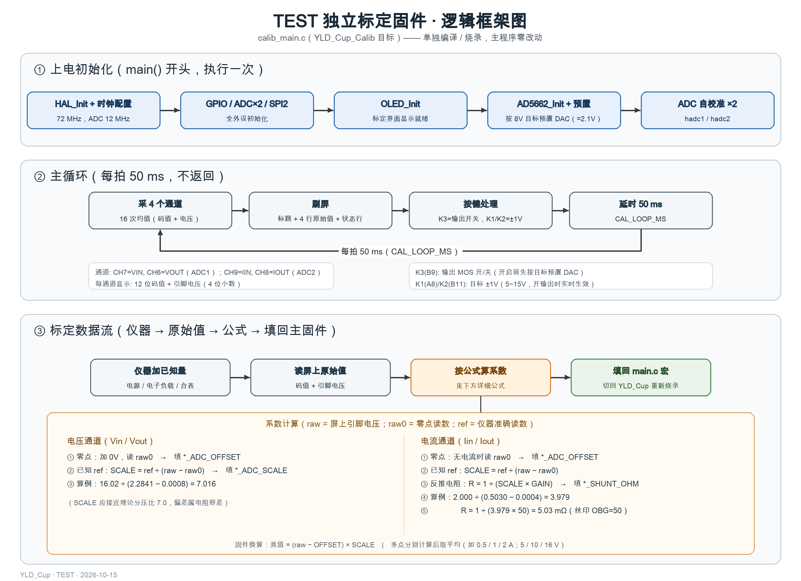

# TEST — 独立采样标定固件

本目录是一个**独立固件**：单独编译、单独烧录，整机上只跑这个标定工具，不依赖也不改动主程序。

用途：在本板上实测**电流采样链路**（采样电阻 R6/R7 × INA199 增益）和**电压分压系数**（Vin / Vout 两路的 ÷7 网络），把结果填回 `Core/Src/main.c` 顶部的宏。界面实时显示 4 个通道的 12 位 ADC 码值和引脚原始电压，你用仪器提供已知的输入/输出电压电流，对照读数即可反推系数。



## 1. 编译与烧录（独立固件，不碰主程序）

- **CLion**：复制一份运行/调试配置，把 **Target 换成 `YLD_Cup_Calib`**，构建下载即可；Target 选回 `YLD_Cup` 就是正常主固件。
- **命令行**：

```bash
cmake --build --preset Debug --target YLD_Cup_Calib   # 产物 build/Debug/TEST/YLD_Cup_Calib.elf
```

- 烧录方式与平时相同，只是烧的是 `YLD_Cup_Calib.elf`；测完把主固件烧回去即恢复正常功能。
- 应用逻辑全部在单个文件 `calib_main.c` 里（自带 main、时钟与全部外设初始化），只复用板级文件和 OLED / AD5662 驱动；主固件源文件零改动。

## 2. 界面与按键

```
CALIB MODE (RAW)      <- 标题
VIN  2831 +2.2814V    <- 标签 | 12 位码值 | 引脚电压 (16 次均值, 4 位小数)
VOUT xxxx +x.xxxxV
IIN  xxxx +x.xxxxV
IOUT xxxx +x.xxxxV
OUT OFF  SET 8.0V     <- 输出通断 / 开环 DAC 目标 (不进闭环, 无保护)
K3:OUT K1/K2:SET
AVG=16 SAMPLES
```

- **K3（B9）**：输出 MOS 开 / 关（打开前自动把 DAC 按目标预置好）；**K1（A8）/ K2（B11）**：目标 ±1V（5~15V），开输出时立即生效。
- 标定模式没有保护逻辑：带负载调试前请把电源限流、电子负载挡位先设好。

## 3. 测量与计算（详细）

### 3.0 三个符号与总关系

| 符号 | 含义 | 从哪来 |
| --- | --- | --- |
| `raw` | 屏上"引脚电压"（4 位小数）——信号进 ADC 前被分压/放大后的电压 | 标定界面实时显示 |
| `raw0` | 零点读数：0V / 无电流时的 `raw` | 标定界面（输出关断、输入加 0V） |
| `ref` | 准确读数：电源 / 台表 / 电子负载显示的值 | 仪器读数 |

固件对四个通道统一按这条式子换算：

```
真值 = (raw − OFFSET) × SCALE
```

标定就是给每个通道定出一组 `(OFFSET, SCALE)`：先把零点减掉，再乘比例系数。

### 3.1 电压通道（定分压系数）

原理：`raw = 真实电压 ÷ 分压比`，所以实测 `SCALE` 就约等于"÷7 分压网络"的真实分压比。

1. **零点（必须）**：Vin 端加 0V（板子由第二路电源供电，不受影响），读屏上 raw0 → 填 `VIN_ADC_OFFSET = raw0`。
2. **系数（单点就够）**：加一个稳定电压（如 16V，台表读 ref = 16.02V），读 raw → `VIN_ADC_SCALE = ref ÷ (raw − raw0)`。
3. **更稳的做法（多点）**：在 5V / 10V / 16V 各测一次，每点各算一个 SCALE 取平均；或用两点式 `SCALE = (ref₂ − ref₁) ÷ (raw₂ − raw₁)`。

算例：raw0 = 0.0008V；16.02V 时 raw = 2.2841V →
`SCALE = 16.02 ÷ (2.2841 − 0.0008) ≈ 7.016` → 填 `VIN_ADC_SCALE = 7.016f`。
（接近理论 7.0 属正常，偏差来自分压电阻容差。**直接填实测值**，不要填 7.0，也不是倒数。）

Vout 通道同理：输出关断时读零点；再开输出与台表对比，或从输出端子外加 0~15V 测系数。

### 3.2 电流通道（定采样链路）

原理链：`raw = 电流 × 采样电阻 R × INA199 增益 G`，反过来就是 `电流 = raw ÷ (R × G)`，
也就是固件里的 `SCALE = 1 ÷ (R × G)`。所以分两步：先测等效 `SCALE`，再反推 `R = 1 ÷ (SCALE × G)`。

1. **零点（必须）**：输出关断、确认无电流，读 raw0 → 填 `IIN/IOUT_ADC_OFFSET = raw0`。
   （INA199 失调最大 ±150µV，折算到 5mΩ 上约 30mA，不校零很容易顶掉 3% 指标。）
2. **等效 SCALE**：加一个已知电流（如 2.000A，仪器读数作 ref），读 raw → `SCALE = ref ÷ (raw − raw0)`。
3. **反推采样电阻**：`R = 1 ÷ (SCALE × GAIN)` → 填 `IIN/IOUT_SHUNT_OHM`。GAIN 按丝印取（OBG=50 / OBH=100 / OBI=200）。

算例（输出电流，GAIN = 50）：raw0 = 0.0004V；2.000A 时 raw = 0.5030V →
`SCALE = 2.000 ÷ (0.5030 − 0.0004) ≈ 3.979` →
`R = 1 ÷ (3.979 × 50) ≈ 0.005026 Ω` → 填 `IOUT_SHUNT_OHM = 0.00503f`。

**完整一轮（照着做）**：

| 步骤 | 操作 | 记录 | 计算 |
| --- | --- | --- | --- |
| 1 | 输出关断 | raw0 = 0.0004 | 填 `IOUT_ADC_OFFSET` |
| 2 | 电子负载 1.000A | raw = 0.2516 | SCALE₁ = 1.000 ÷ (0.2516 − 0.0004) ≈ 3.981 |
| 3 | 电子负载 2.000A | raw = 0.5030 | SCALE₂ = 2.000 ÷ (0.5030 − 0.0004) ≈ 3.979 |
| 4 | 取平均 | — | SCALE = (3.981 + 3.979) ÷ 2 ≈ 3.980 |
| 5 | 反推电阻 | — | R = 1 ÷ (3.980 × 50) ≈ 0.005025 Ω → 填 `0.00503f` |
| 6 | 复核 | 负载 1.500A | 正常固件显示应 ≈ 1.50A，误差 ≤3% 即达标 |

- **输入电流**：开输出带载（如 1~2A），用电源显示的输入电流作 ref，反推 `IIN_SHUNT_OHM`。
- **输出电流**：电子负载读数最准，反推 `IOUT_SHUNT_OHM`。
- 如果电阻值实在测不出：用假定增益反推出的"等效电阻"直接填宏——误差全部折算进 (R×G) 乘积，效果一样。
- 填完先复核：正常固件上抽 1~2 个点与台表对比；若仍超差，按 `SCALE新 = SCALE旧 × ref ÷ 显示值` 微调一次即可。

## 4. 填回哪里

全部在 `Core/Src/main.c` 顶部（USER CODE PD 区）：

| 测出的量 | 填的宏 |
| --- | --- |
| Vin / Vout 分压系数 | `VIN_ADC_SCALE` / `VOUT_ADC_SCALE` |
| 电压零点 | `VIN_ADC_OFFSET` / `VOUT_ADC_OFFSET` |
| R6 / R7 实测阻值（Ω） | `IIN_SHUNT_OHM` / `IOUT_SHUNT_OHM` |
| INA199 增益（一般按丝印 50/100/200） | `INA199_GAIN` |
| 电流零点 | `IIN_ADC_OFFSET` / `IOUT_ADC_OFFSET` |

填完把主固件（CLion 里 Target 选回 `YLD_Cup`）重新编译烧录，正常界面的读数就能和台表对上了。

## 5. 注意

- 标定读数有 ±1~2 个字跳动很正常（12 位 ADC + 电源纹波），取稳定段的平均。
- 标定模式的采样逻辑与主固件一致（CH7=Vin、CH6=Vout、CH9=Iin、CH8=Iout），只是过采样取 16 次均值（正常固件是 4 次），读数会略稳。
- 本固件不含主程序逻辑：没有过流/欠压保护、没有蜂鸣、显示也不走状态机。
